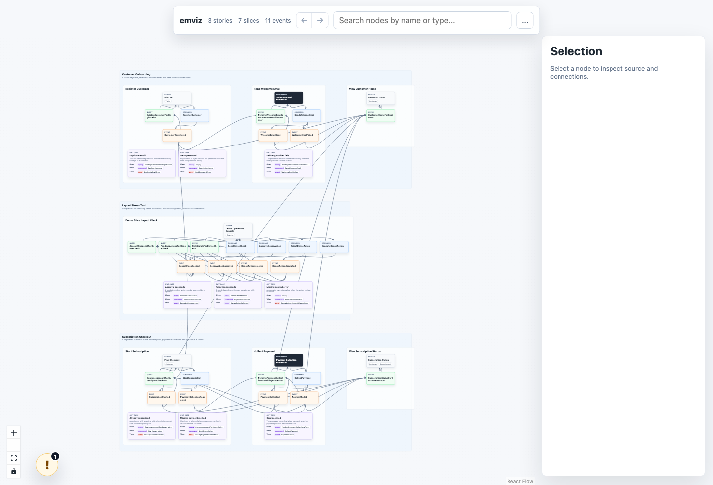
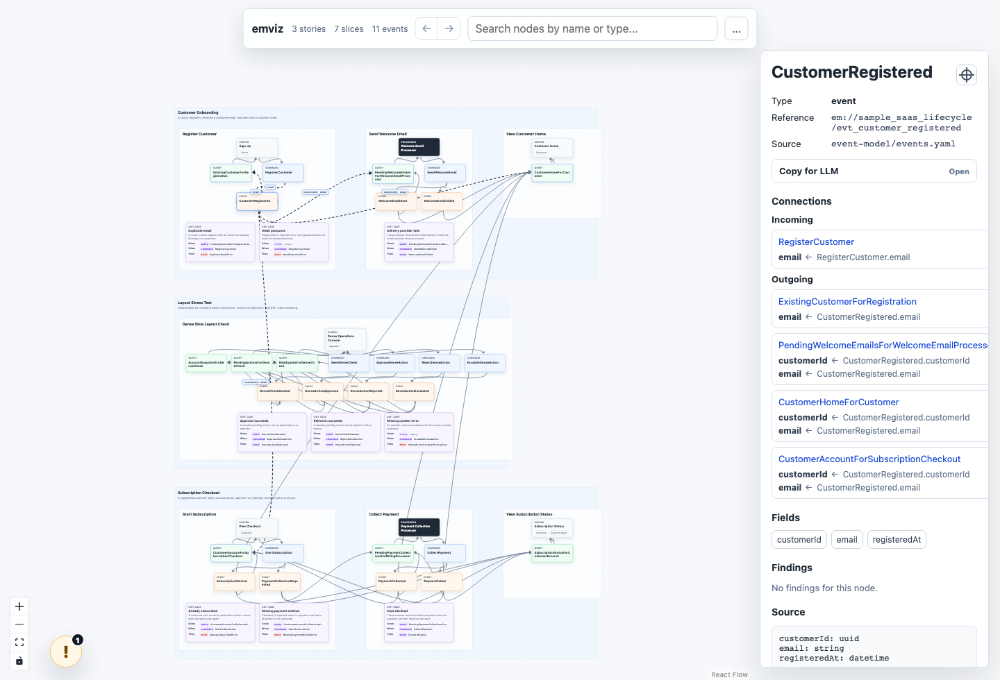
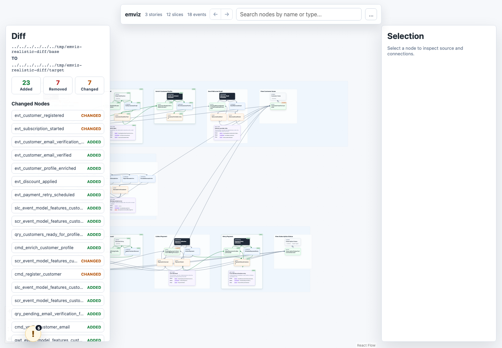
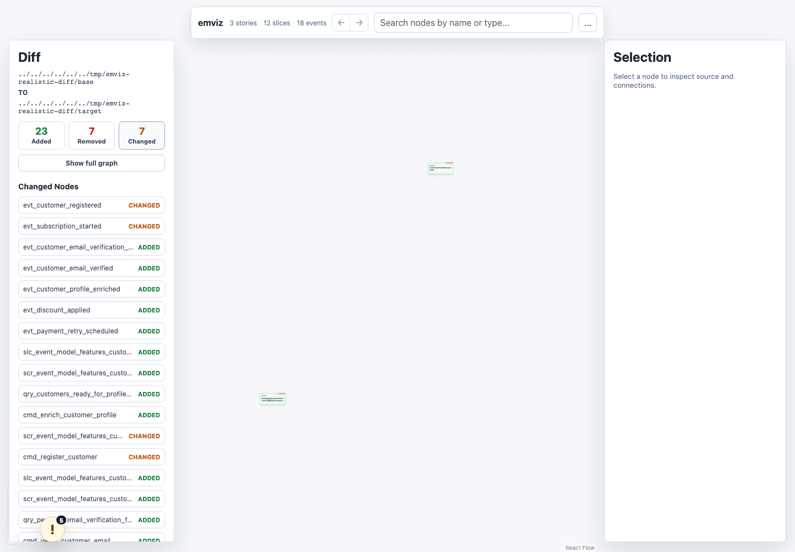

# emviz

`emviz` is an interactive visualizer for Event Modeling YAML projects. It renders stories, slices, screens, processors, commands, events, queries, and GWT cases as a directed graph so you can inspect model structure and trace behavior across slices.

It is not a YAML editor. The canonical model stays in your Event Modeling files; `emviz` helps you understand the graph, find validation issues, and copy precise context for LLM-assisted edits.



## Features

1. **Visualize Event Modeling YAML**
   - Story lanes and slice groups show the narrative flow.
   - Screens, processors, commands, events, queries, and GWT cases are rendered as graph nodes.

2. **Trace connections**
   - Click a node to inspect incoming and outgoing connections.
   - Search by node name, type, or source path.
   - Select a field name to see where data flows through events and queries.

3. **Review validation findings**
   - Open the validation drawer to inspect errors and warnings.
   - Focus findings directly on the related graph node.
   - Detect stale `.event-modeling/graph.json` selectors and other model drift.

4. **Copy context for LLM workflows**
   - Copy `em://...` node references with source context.
   - Copy YAML excerpts, connected context, or an edit-prompt scaffold.

5. **Send feedback to your own agent**
   - Start your LLM agent separately and use the `emviz` skill to open the viewer and receive feedback.
   - Select a node, send feedback, and review the agent's reply with current, session, and turn views.
   - The agent edits canonical YAML directly. The local server does not invoke an LLM or commit changes.

6. **Compare model versions**
   - Run `emviz diff` against a git ref or another project directory.
   - Review added, removed, and changed nodes on the same canvas.
   - Filter the canvas to focus on one kind of change.



## Quick Start

Run `emviz` from the root of an Event Modeling project:

```sh
npx emviz .
```

The CLI prints a local URL:

```text
  ->  Local:   http://localhost:5173/
Project: /path/to/your/project
```

If `.event-modeling/graph.json` is missing, `emviz` creates it on first project-mode startup.

## Companion Skills

Install the companion skills together before using the agent workflows:

```sh
gh skill install craftell/em
```

The installed skills provide:

1. `em-model` for creating canonical Event Modeling YAML.
2. `em-extract` for extracting candidate models from code or an Understand Anything knowledge graph.
3. `em-lint` for validating Event Modeling YAML.
4. `emviz` for opening the viewer and keeping the active agent in a feedback loop.
5. `em-feedback` as the existing entry point to the same workflow.

The distributable skills live under `skills/`. Ask your running agent to use
`emviz`, or invoke `/emviz` if your agent supports slash commands. Install all
companion skills so modeling and validation references are available. Installing
skills does not install the CLI. The launcher uses a project-local CLI or
`npx emviz@0.4.0` when package execution is permitted.

## Usage

1. **Open a project**

   ```sh
   npx emviz .
   ```

   Loads the current directory as an Event Modeling project. This is the normal daily-use mode.

2. **Update the visualizer sidecar**

   ```sh
   npx emviz sync .
   ```

   Creates or updates `.event-modeling/graph.json`. Existing node IDs are preserved when possible.

3. **Use manual import mode**

   ```sh
   npx emviz
   ```

   Opens the browser app without a project server. Import a folder or select YAML / JSON files in the browser. This is useful for demos and one-off inspection.

4. **Export a standalone HTML file**

   Use the `...` menu in the top-right toolbar and choose `Export`. The exported HTML embeds the current model and can be opened without the project server.

5. **Compare two versions**

   ```sh
   npx emviz diff HEAD~1
   ```

   Compares the current project with a git commit, branch, or tag. The current working tree is used as the target.

   ```sh
   npx emviz diff --from HEAD~1 --to .
   npx emviz diff --from ../old-event-model --to .
   ```

   `--from` is the base model and `--to` is the target model. Each side can be a git ref or an Event Modeling project directory.

## Work with an external agent

Start your preferred LLM agent in the project directory. Ask it to use the [emviz skill](skills/emviz/SKILL.md), for example:

```text
Use emviz to open this project's Event Model and keep handling my browser feedback.
```

In this repository, the same request opens emviz's own Event Model.

The agent runs `emviz open .` and gives you the returned local URL. Open that URL, select a node, and send a message from **Node feedback**. The agent receives the selected node's context, edits the YAML files, and replies. It replies before polling for your next message. Each idle poll lasts up to 25
seconds; a timeout starts another poll.

The viewer runs as a detached local server. The LLM must remain active to read
requests and make edits. A skill file cannot wake a finished or suspended agent.
If your agent cannot continue, it must report that monitoring stopped. Resume the
skill in that agent to continue with the existing session.

Use **Current** to inspect files on disk, **Session diff** to compare with the fixed session baseline, and **Turn diff** to review the most recent completed request. A turn diff includes every file change between claim and reply, including concurrent manual edits. It does not identify who made each change.

**Stop session** stops feedback. **Resume session** starts accepting feedback again, but you must restart the external agent's poll loop after it exits. Restarting the server discards request history.

Node IDs can change when names collide. Feedback captures the current reference, source, context, and file revision. Re-select a node if the model changes before the request starts.

See the [CLI command reference](packages/cli/README.md) for session commands, limits, and cleanup.

## Actors

Define optional actor names and colors in `event-model/actors.yaml`:

```yaml
actors:
  Visitor:
    name: Visitor
    color: "#2563EB"
  Support:
    name: Support team
    color: "#7C3AED"
```

Reference the IDs in existing user screens. A screen can have several actors:

```yaml
slice: Register Customer
screen:
  type: user
  name: Sign Up
  actors: [Visitor, Support]
  reads: [ExistingCustomerForRegistration]
  executes: [RegisterCustomer]
```

Actor IDs are case-sensitive, nonempty strings without surrounding whitespace. Names are optional and default to the ID. Colors are optional, quoted six-digit hex values. Missing colors use a stable palette based on the ID. Colors identify tags; node fills keep their modeling meaning.

Without a registry file, existing `screen.actors` values remain valid and supply the actor list. With a registry file, undeclared references produce validation findings and still display their IDs. Invalid names, colors, IDs, duplicate references, and malformed registries also produce findings. System screens cannot declare actors.

Use **Actors** in the toolbar to select one or more actors. Selections match any selected actor. **Unassigned screens** selects user screens without actors. Clear the selection to restore the full graph.

A matching screen retains its complete slice, GWT cases, and connected events. Directly adjacent system slices remain visible as **Related** context. Context expansion stops after one system slice; it does not follow an entire automation chain or assign user actors to processors. Existing story and diff restrictions still apply. Filtering keeps node positions unchanged.

Diff views match both old and new actor references. Actor name or color edits mark affected screens as changed, and old versions retain their original tags. Standalone HTML includes the actor metadata and filter controls.

To place the registry elsewhere, set `paths.actors_file` in `.event-modeling/config.yaml`. The default follows `paths.event_model_dir`. Keep the file inside the project directory.

## Diff View

`emviz diff` opens the normal canvas with diff metadata layered onto the graph. Node fills keep their semantic colors. Added nodes have green outlines and badges, changed nodes have amber outlines and badges, and removed nodes are dashed red ghosts. Edge colors show the same change statuses.



The left panel summarizes changed nodes and provides filters for added, removed, and changed graph elements.



## Input Files

`emviz` expects the Event Modeling YAML layout produced by the `em-model` and `em-extract` workflows:

```text
.event-modeling/
  config.yaml
  graph.json

event-model/
  events.yaml
  actors.yaml     # optional
  stories/
    *.yaml
  features/
    **/*.slice.yaml
```

`.event-modeling/config.yaml` is owned by the modeling workflow. `.event-modeling/graph.json` is owned by `emviz` and stores visualizer selectors and node IDs. Keeping that sidecar separate avoids adding visualizer-only IDs to canonical slice YAML.

## Interface

1. **Toolbar**
   - Shows story, slice, and event counts.
   - Provides back / forward selection history.
   - Searches nodes by name, type, or source path.

2. **Canvas**
   - Shows stories and slices as background groups.
   - Draws behavior flow from screen / processor to command, command to event, and event to query.
   - Uses React Flow controls for zoom and fit view.

3. **Selection panel**
   - Shows the selected node type, current reference, source path, and source excerpt.
   - Lists incoming and outgoing connections.
   - Provides `Copy for LLM` actions for reference, YAML, context, and edit prompt.

4. **Validation drawer**
   - Open it from the `!` button in the lower-left corner.
   - Use `Focus` on a finding to jump to the related node.

## Understand Anything Integration

`emviz` does not directly render `.understand-anything/knowledge-graph.json`. The integration path goes through `em-extract` and [Understand Anything](https://github.com/Egonex-AI/Understand-Anything):

1. **Analyze the codebase with Understand Anything**

   ```text
   .understand-anything/knowledge-graph.json
   ```

   Understand Anything produces a knowledge graph of implementation entities and relationships.

2. **Extract candidate Event Modeling artifacts with `em-extract`**

   When `.understand-anything/knowledge-graph.json` is present, `em-extract` prefers it over broad code search. It uses implementation evidence such as routes, use cases, jobs, database writes, queries, and integrations to propose stories, slices, commands, events, and queries.

3. **Confirm and write Event Modeling YAML**

   Treat extraction output as a proposal. After domain review, write canonical YAML under `event-model/` using the `em-model` format.

4. **Visualize the result**

   ```sh
   npx emviz sync .
   npx emviz .
   ```

5. **Iterate with LLM assistance**

   Select a node in `emviz`, open `Copy for LLM`, and copy the reference, context, or edit prompt. Stable references use the `em://<model-id>/<node-id>` format, which makes follow-up edits easier to target.

## Local Development

This repository is a pnpm workspace.

```sh
pnpm install
pnpm build
pnpm test
```

Run the app during development:

```sh
pnpm dev
```

Run the local CLI build:

```sh
pnpm build
node packages/cli/dist/index.js .
```

The feedback verification guide is a [DRAFT](.agents/skills/verify-emviz/SKILL.md). Its real-browser script has not been run during this change.

## Package Layout

```text
packages/
  app/        # Vite + React visualizer
  cli/        # npx emviz entrypoint
  parser/     # Event Modeling YAML -> normalized graph
  validator/  # schema / graph / modeling checks
  graph/      # .event-modeling/graph.json sidecar

skills/
  em-model/    # Creates Event Modeling YAML
  em-extract/  # Extracts candidates from code or an Understand Anything graph
  em-lint/     # Validates Event Modeling YAML
  emviz/       # Opens the viewer and runs the agent feedback loop
  em-feedback/ # Compatibility entry point for the emviz workflow
```

## References

- [Architecture Spec](docs/emviz-architecture.md)
- [CLI README](packages/cli/README.md)
